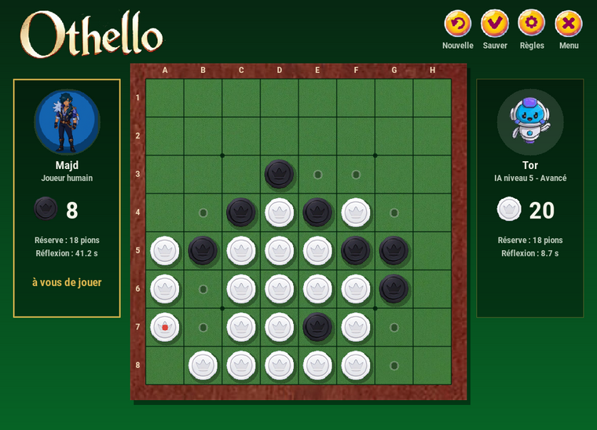
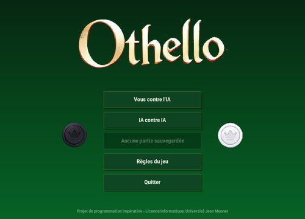
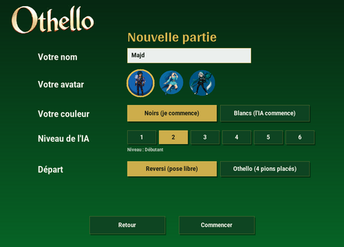
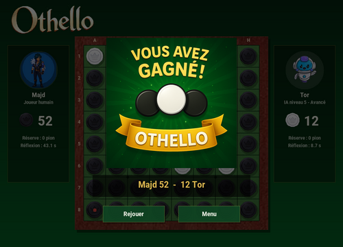
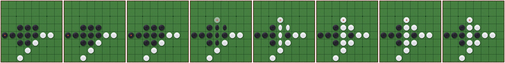

# Othello / Reversi en C (SDL2)

Jeu de **Reversi** (variante d'Othello) en **C (norme C89)**, avec une interface graphique **SDL2**, un mode terminal et une **intelligence artificielle à 6 niveaux** (minimax, élagage alpha-bêta, fin de partie calculée exactement). Projet de programmation impérative de Licence 2 Informatique, à l'Université Jean Monnet (Saint-Étienne).



| Menu | Configuration | Fin de partie |
|---|---|---|
|  |  |  |

## Fonctionnalités

- **Règles complètes du Reversi** : départ avec pose libre des 4 premiers pions au centre (ou départ classique d'Othello), retournements dans les 8 directions, tour passé quand un joueur est bloqué, fin de partie dès que plus personne ne peut jouer, réserve de 32 pions par joueur.
- **Interface graphique** : coups possibles indiqués sur le plateau, aperçu du pion au survol, animation des pions retournés, dernier coup marqué, temps de réflexion de chaque joueur.
- **Vous contre l'IA** (vous choisissez votre nom, votre avatar et votre couleur) ou **IA contre IA** (deux niveaux au choix).
- **Sauvegarde** de la partie et reprise depuis le menu.
- **Mode terminal**, avec l'affichage demandé par le sujet.
- **Tournoi** : un programme fait s'affronter les niveaux de l'IA entre eux.



## L'intelligence artificielle

Chaque niveau correspond à une étape du sujet :

| Niveau | Nom | Méthode |
|---|---|---|
| 1 | Hasard | Un coup possible tiré au hasard |
| 2 | Débutant | Arbre de jeu de profondeur 2 (pointeurs), minimax, évaluation par le nombre de pions |
| 3 | Intermédiaire | Arbre de profondeur réglable (`-prof`, 4 par défaut), évaluation des ensembles de 2 et 3 pions consécutifs |
| 4 | Confirmé | Élagage **alpha-bêta** : les branches inutiles ne sont jamais créées. Évaluation pondérée par région du plateau, avec la mobilité |
| 5 | Avancé | Alpha-bêta sur un **plateau unique** (on joue puis on annule les coups) : l'arbre n'est jamais stocké en mémoire, les coups sont triés pour élaguer davantage (profondeur 7) |
| 6 | Expert | Approfondissement itératif, évaluation plus fine (pions « frontière », cases voisines des coins), et **fin de partie calculée exactement** quand il reste 14 cases vides ou moins (profondeur 8) |

La recherche alpha-bêta est vérifiée par les tests : elle doit trouver exactement la même valeur qu'un minimax complet.

### Résultats du tournoi entre niveaux

`./bin/tournoi -parties 6` : chaque paire de niveaux joue 6 parties, en alternant les couleurs, après 4 premiers coups tirés au hasard.

```
        niv1 niv2 niv3 niv4 niv5 niv6   total
niv1       -    2    1    0    0    0     3 / 30   (0.000 s par coup)
niv2       3    -    2    0    0    0     5 / 30   (0.000 s par coup)
niv3       5    4    -    0    0    0     9 / 30   (0.015 s par coup)
niv4       6    6    6    -    1    0    19 / 30   (0.013 s par coup)
niv5       6    6    6    5    -    0    23 / 30   (0.136 s par coup)
niv6       6    6    6    6    4    -    28 / 30   (0.537 s par coup)
```

Chaque niveau bat tous les niveaux inférieurs. Le niveau 6 ne perd aucune partie (2 nuls contre le niveau 5) et joue en moins d'une seconde par coup.

## Installation

Le jeu utilise **SDL2**, **SDL2_ttf** et **SDL2_image**.

```bash
# macOS (Homebrew)
brew install sdl2 sdl2_ttf sdl2_image pkg-config

# Ubuntu / Debian
sudo apt install libsdl2-dev libsdl2-ttf-dev libsdl2-image-dev pkg-config
```

## Utilisation

```bash
make                                   # compile bin/othello et bin/tournoi
./bin/othello                          # interface graphique
./bin/othello -mode Console            # dans le terminal
./bin/othello -niveau 6                # IA de niveau 6
./bin/othello -niveau 3 -prof 5        # niveau 3 avec un arbre de profondeur 5
./bin/othello -depart othello          # départ classique (4 pions déjà placés)
./bin/tournoi -parties 10 -niveaux 4,5,6
make test                              # tests unitaires
```

Le jeu se lance depuis la racine du projet, car il charge ses images depuis `assets/`.

En mode terminal, on tape la colonne puis la ligne (`D3`), ou `aide`, `sauver` et `quitter` :

```
   ________________
1 | . . . . . . . .|
2 | . . . . . . . .|
3 | . . . + . . . .|
4 | . . + B N . . .|
5 | . . . N B + . .|
6 | . . . . + . . .|
7 | . . . . . . . .|
8 | . . . . . . . .|
   ----------------
    A B C D E F G H
```

Les `+` montrent les coups possibles du joueur humain.

## Organisation du code

```
src/
├── plateau.c     règles : coups valides, retournements, passes, fin de partie
├── partie.c      joueurs, tour de jeu, sauvegarde
├── ia.c          fonctions d'évaluation, arbre de jeu, minimax, alpha-bêta
├── console.c     mode terminal
├── graphique.c   couche graphique au-dessus de SDL2
├── interface.c   écrans et boucle de jeu graphique (l'IA réfléchit dans un thread)
├── tournoi.c     tournoi entre les niveaux de l'IA
└── main.c        options de la ligne de commande
tests/
└── test_othello.c   87 tests : règles, passes, arbre, alpha-bêta = minimax, sauvegarde
```

Les règles et l'IA (`plateau.c`, `partie.c`, `ia.c`) ne dépendent pas de SDL. Elles sont partagées par l'interface graphique, le mode terminal, le tournoi et les tests.

## Corrections par rapport à la version rendue

Ce dépôt est une version reprise du projet rendu en cours, qui utilisait la bibliothèque MLV de l'université.

| Problème de la version d'origine | Correction |
|---|---|
| Ne compilait pas : conflit Git non résolu dans `Affichage.c` | Code réorganisé et compilé sans aucun avertissement (gcc et clang) |
| Interface bloquée après le choix de la couleur | Nouvelle interface SDL2 |
| La partie ne se terminait que quand le plateau était plein | Fin dès qu'aucun joueur ne peut jouer, gestion des passes |
| L'IA construisait un arbre puis l'ignorait, et choisissait toujours le premier coup | Minimax et alpha-bêta corrects, vérifiés par les tests |
| Fuites de mémoire à chaque coup de l'IA | Arbres libérés, aucune fuite (vérifié avec AddressSanitizer) |
| 32 fonctions presque identiques (une par direction et par couleur) | Une seule fonction générique pour les 8 directions |
| Le départ Reversi (pose libre des 4 premiers pions) n'était pas géré | Départ Reversi et départ Othello |

## Auteurs

Projet réalisé par **Majd CHAMAS**.
